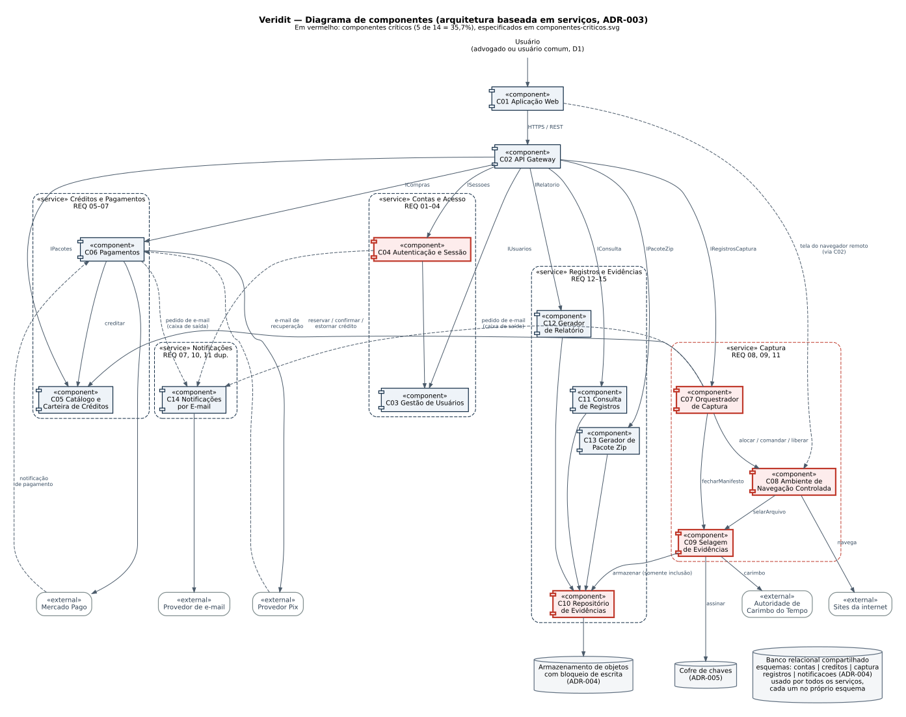

# Veridit — Documentação Arquitetural

Trabalho II de Engenharia de Software I (UFBA), Prof. Eduardo Almeida.
Equipe: Cauã Marinho, João Ferraz, Davi Araújo, Guilherme Loiola e Pedro Azevedo.

O Veridit é uma plataforma para registrar conteúdo de sites (imagem da tela ou vídeo de navegação) como evidência, com relatório e pacote de arquivos para download.

## Decisões principais

| ADR | Decisão |
|---|---|
| [ADR-001](docs/adr/ADR-001-top4-caracteristicas.md) | Top 4: Segurança, Integridade da evidência, Confiabilidade da captura, Modularidade |
| [ADR-002](docs/adr/ADR-002-captura-em-navegador-da-plataforma.md) | Captura em navegador isolado na infraestrutura do Veridit |
| [ADR-003](docs/adr/ADR-003-estilo-baseado-em-servicos.md) | Estilo baseado em serviços (5 serviços, gateway, banco compartilhado) |
| [ADR-004](docs/adr/ADR-004-dados-compartilhados-e-evidencias-imutaveis.md) | Banco com esquema por serviço; evidências em armazenamento imutável |
| [ADR-005](docs/adr/ADR-005-selagem-das-evidencias.md) | Selagem na origem: hash encadeado, manifesto assinado, carimbo de tempo |
| [ADR-006](docs/adr/ADR-006-autenticacao-centralizada-no-gateway.md) | Autenticação centralizada, token validado no gateway |
| [ADR-007](docs/adr/ADR-007-pagamentos-por-adaptadores.md) | Pagamentos por adaptadores, créditos só após confirmação do provedor |
| [ADR-008](docs/adr/ADR-008-comunicacao-assincrona-por-caixa-de-saida.md) | Caixa de saída transacional para e-mails e pedidos entre serviços |
| [ADR-009](docs/adr/ADR-009-ciclo-de-vida-da-captura.md) | Máquina de estados da captura, com reserva e estorno de créditos |

## Estrutura

```
docs/
├── requisitos/veridit-req.md        documento de requisitos (transcrição)
├── analise-requisitos.md            Etapa 1
├── caracteristicas.md               Etapa 2
├── priorizacao-caracteristicas.md   Etapa 3 (apoio à ADR-001)
├── comparacao-estilos.md            Etapa 4 (apoio à ADR-003)
├── componentes.md                   Etapas 5 e 6
├── adr/                             ADR-001 a ADR-009
├── taticas.md                       Etapa 8
├── diagramas/                       componentes, críticos e módulos (.dot, .svg, .png)
├── telas.md                         Etapa 10
├── auditoria.md                     Etapa 11 e pendências para o professor
└── registro-ia/                     registro das interações com IA
```

## Diagramas

Os diagramas são gerados com [Graphviz](https://graphviz.org/) a partir dos arquivos `.dot`:

```bash
cd docs/diagramas
for f in componentes componentes-criticos modulos; do
  dot -Tsvg $f.dot -o $f.svg && dot -Tpng -Gdpi=150 $f.dot -o $f.png
done
```


