# Veridit — Documento de Arquitetura

**Disciplina:** Engenharia de Software I — Trabalho II
**Professor:** Dr. Eduardo Almeida
**Equipe:** Cauã Marinho, João Ferraz, Guilherme Loiola e Davi Araújo
**Versão:** 1.1 — 20/10/2026
**Base:** Documento de Requisitos Veridit v01.00 (REQ01–REQ15, D1, D2, Apêndice A)

---

## 1. Introdução

O Veridit é uma plataforma para registrar conteúdo da internet. O usuário (advogado ou usuário
comum) compra créditos, informa o endereço de um site e captura uma tela ou grava um vídeo da
navegação. Ao final, recebe um relatório e um arquivo .zip com o que foi capturado, que
podem ser usados como prova.

Este documento descreve a arquitetura proposta seguindo a abordagem de Richards & Ford
(*Fundamentals of Software Architecture*): identificação das características arquiteturais,
escolha das prioritárias, identificação de componentes, escolha do estilo e registro das
decisões em ADRs. As táticas de cada característica seguem o catálogo de Bass, Clements &
Kazman (*Software Architecture in Practice*).

### 1.1 Premissas e interpretações dos requisitos

| # | Premissa | Validar com o cliente? |
|---|---|---|
| P1 | O documento de requisitos tem dois "REQ 11". Chamamos o segundo ("Confirmar captura de tela por email") de **REQ11-B**. | Sim |
| P2 | "Pagamento pela plataforma do Veridit" (REQ06) significa pagar via Pix sem sair da interface do Veridit; o QR Code é gerado pelo provedor de pagamento (ADR-0006). | Sim |
| P3 | A quantidade de créditos consumida por registro (tela ou vídeo, duração do vídeo) não está definida; será configurável no catálogo (ADR-0008). | Sim |
| P4 | O registro tende a ser usado como prova, já que advogados são público-alvo (D1). Isso torna a integridade das evidências uma característica implícita. | Sim |
| P5 | Nesta etapa não há implementação; tecnologias citadas (PostgreSQL, RabbitMQ, Playwright etc.) são exemplos que podem ser trocados por equivalentes. | Não |

---

## 2. Características arquiteturais

Identificamos as características a partir de três fontes, como propõem Richards & Ford: os
requisitos explícitos (o atributo de qualidade "Segurança"), os requisitos funcionais que
implicam características (pagamento, e-mails obrigatórios, captura de vídeo) e o conhecimento
do domínio (registro de conteúdo com valor de prova). Classificamos cada uma como operacional,
estrutural ou transversal e indicamos se é explícita ou implícita.

O livro alerta contra a "arquitetura genérica", que tenta suportar todas as características
e acaba complexa sem atender bem a nenhuma. Por isso, listamos abaixo todas as características
relevantes, mas só quatro direcionam a estrutura (seção 3); as demais são atendidas por táticas
locais (seção 9).

| # | Característica | Categoria | Origem | Justificativa | Requisitos |
|---|---|---|---|---|---|
| 1 | **Segurança** | Transversal | Explícita | Único atributo de qualidade do documento: acesso só por usuários cadastrados. O sistema guarda CPF, OAB, endereço e lida com pagamento. | QA Segurança, REQ01–REQ07 |
| 2 | **Integridade e autenticidade das evidências** | Transversal | Implícita | O relatório e o .zip só têm valor se for possível provar que não foram alterados e quando foram obtidos. | REQ08–REQ15, D1 |
| 3 | **Confiabilidade** | Operacional | Implícita | O usuário paga antes de usar: pagamento confirmado precisa virar crédito, e crédito não pode ser perdido quando a captura falha. Os e-mails de confirmação são de prioridade alta. | REQ05–REQ11-B |
| 4 | **Escalabilidade / elasticidade** | Operacional | Implícita | Cada captura ocupa um navegador dedicado por minutos (CPU, memória, vídeo), com demanda irregular. | REQ08–REQ11 |
| 5 | Disponibilidade | Operacional | Implícita | Um conteúdo pode sair do ar a qualquer momento; se o sistema estiver fora, a prova se perde. | REQ03, REQ08 |
| 6 | Desempenho | Operacional | Implícita | A navegação no navegador remoto precisa ser fluida; listagens e detalhes precisam responder rápido. | REQ08, REQ12, REQ13 |
| 7 | Recuperabilidade | Operacional | Implícita | Evidências e o livro-razão de créditos não podem ser perdidos em falhas graves. | REQ12–REQ15 |
| 8 | Auditabilidade | Transversal | Implícita | Cadeia de custódia das evidências e histórico de créditos para contestações. | REQ05, REQ08–REQ15 |
| 9 | Privacidade (LGPD) | Transversal | Implícita | Dados pessoais (CPF, telefone, endereço, OAB) e dados de terceiros nas capturas. | Apêndice A, REQ01, REQ05 |
| 10 | Extensibilidade / configurabilidade | Estrutural | Implícita | Empresas como novo tipo de usuário (D1), pacotes definidos pelo negócio (D2), novos tipos de captura. | D1, D2, REQ05 |
| 11 | Interoperabilidade | Estrutural | Implícita | Integração com Mercado Pago, Pix, provedor de e-mail e Autoridade de Carimbo do Tempo. | REQ06, REQ07, REQ10, REQ11-B |
| 12 | Manutenibilidade e testabilidade | Estrutural | Implícita | O projeto terá etapas de implementação e evolução feitas pela equipe. | Todos |

---

## 3. Top 4 características arquiteturais

> Decisão registrada em [ADR-0001](adr/0001-top4-caracteristicas.md).

| Prioridade | Característica | Por que está no top 4 | Cenário mensurável (meta inicial) |
|---|---|---|---|
| 1 | Segurança | Explícita; dados pessoais e de pagamento | 100% dos endpoints não públicos rejeitam requisição sem token válido; nenhuma senha armazenada de forma reversível |
| 2 | Integridade e autenticidade das evidências | Sem ela o produto perde o valor de prova | Alterar qualquer byte do pacote é detectado pela verificação; 100% dos registros concluídos têm hash e carimbo do tempo |
| 3 | Confiabilidade | Dinheiro e créditos do usuário | Com webhooks duplicados ou queda de serviço no meio do fluxo, 0 créditos duplicados ou perdidos |
| 4 | Escalabilidade (elasticidade da captura) | A captura tem perfil de carga diferente de todo o resto | 10x sessões simultâneas absorvidas só adicionando workers; espera p95 por sessão ≤ 30 s |

Escolhemos as características cuja falha torna o produto inútil ou perigoso e que mudam a forma
da arquitetura. Segurança é a única explícita. Integridade é o núcleo do valor: uma evidência
contestável não serve ao advogado. Confiabilidade vem do modelo pré-pago de créditos. Escalabilidade
vem do custo e da irregularidade da captura. Juntas, essas quatro forças levam a separar a
captura do núcleo transacional e a usar comunicação assíncrona.

Ficaram fora do top 4: disponibilidade (sem SLA definido; já beneficiada pela redundância),
desempenho (limitado pelo site de destino), auditabilidade e privacidade (cobertas por táticas
de integridade e segurança) e extensibilidade (atendida no nível dos componentes). A ADR-0001
detalha as alternativas.

---

## 4. Estilo arquitetural

> Decisão registrada em [ADR-0002](adr/0002-estilo-baseado-em-servicos.md).

O Veridit adota o estilo **baseado em serviços** (*service-based*), particionado por domínio,
com **mensageria assíncrona** onde a assincronia é natural (captura, selagem, e-mails e auditoria).

Comparação das notas de Richards & Ford para as características que dependem do estilo:

| Característica | Camadas | Microkernel | **Baseado em serviços** | Orientado a eventos | Space-based | Microsserviços |
|---|---|---|---|---|---|---|
| Escalabilidade | 1 | 1 | **3** | 5 | 5 | 5 |
| Elasticidade | 1 | 1 | **2** | 3 | 5 | 5 |
| Tolerância a falhas | 1 | 1 | **4** | 5 | 3 | 4 |
| Confiabilidade | 3 | 3 | **4** | 3 | 4 | 4 |
| Testabilidade | 2 | 3 | **4** | 2 | 1 | 4 |
| Simplicidade | 5 | 4 | **3** | 1 | 1 | 1 |
| Custo (5 = barato) | 5 | 5 | **4** | 3 | 2 | 1 |

O estilo baseado em serviços tem boas notas em tolerância a falhas, confiabilidade, testabilidade
e custo, com simplicidade razoável para a equipe. Sua fraqueza (elasticidade 2) é tratada
isolando a captura em um serviço com workers sem estado alimentados por fila (ADR-0009). A
separação em serviços também isola o navegador, que abre sites externos não confiáveis, dos
dados pessoais e de pagamento.

### 4.1 Serviços e implantação

| Serviço | Componentes | Escala | Dados | Comunicação |
|---|---|---|---|---|
| Borda | C01, C02 | 2+ réplicas | — | HTTPS, WebSocket |
| S1 Identidade e Acesso | C03, C04, C05 | 2+ réplicas | esquema `identidade` | REST; publica eventos |
| S2 Créditos e Pagamentos | C06, C07, C08, C09 | 2+ réplicas | esquema `creditos` | REST; webhooks; publica eventos |
| S3 Registros | C10, C11 | 2+ réplicas | esquema `registros` | REST; consome e publica eventos |
| S4 Captura | C12 | **elástico** (mín. 2, máx. N) | sem banco; bucket temporário | fila + WebSocket |
| S5 Evidências | C13, C14, C15, C16 | 2+ réplicas | esquema `evidencias`; bucket WORM | eventos; REST de download |
| S6 Notificações | C17 | 1–2 réplicas | sem banco | eventos → e-mail |
| S7 Auditoria | C18 | 1–2 réplicas | esquema `auditoria` | eventos |

**Quanta arquiteturais.** Os serviços que compartilham o banco (S1, S2, S3, S5, S7) formam um
quantum. A Captura (S4) e as Notificações (S6) não acessam o banco e se comunicam só de forma
assíncrona, por isso formam quanta próprios. Isso permite que a Captura tenha características
operacionais diferentes (elasticidade) sem afetar o restante.

---

## 5. Componentes candidatos

Identificamos os componentes com a abordagem **ator/ações** e validamos com a abordagem de
**fluxo de trabalho** (compra de créditos e registro de conteúdo), evitando a "armadilha da
entidade" do livro: componentes são nomeados pelo que fazem (ex.: *Orquestrador de Captura*),
não pelas tabelas que manipulam (ex.: *RegistroManager*).

### 5.1 Atores e ações

| Ator | Ações |
|---|---|
| Advogado / Usuário comum | cadastrar-se, recuperar senha, entrar, sair, comprar créditos, pagar, iniciar registro, navegar e capturar, concluir, listar registros, ver detalhes, baixar relatório e .zip |
| Mercado Pago (sistema externo) | notificar pagamento (webhook) |
| Sistema (tempo) | expirar reservas de créditos, reconciliar pagamentos, verificar integridade das evidências, escalar workers |
| Empresa (futuro, D1) | as mesmas ações do usuário, com dados de pessoa jurídica |

### 5.2 Lista de componentes

| ID | Componente | Serviço | Responsabilidades | Requisitos | Características |
|---|---|---|---|---|---|
| C01 | Aplicação Web (SPA) | Borda | Telas de cadastro, login, compra, sessão de captura (visualização do navegador remoto), listagem, detalhes e downloads | REQ01–REQ15 | Segurança, Desempenho |
| C02 | API Gateway | Borda | Ponto único de entrada: TLS, validação de JWT, lista de revogação, limitação de taxa, roteamento REST e proxy WebSocket das sessões | Todos | Segurança, Escalabilidade |
| C03 | Cadastro de Usuários | S1 | Cadastrar advogado (nome, e-mail, senha, CPF, OAB) e usuário comum (nome, e-mail, senha, CPF); validar CPF e OAB; verificar e-mail; preparado para empresa (D1) | REQ01, D1 | Segurança, Privacidade, Extensibilidade |
| C04 | Autenticação e Sessão | S1 | Login, emissão e renovação de tokens, logout com revogação, proteção contra força bruta, publicação de chaves (JWKS) | REQ03, REQ04 | Segurança |
| C05 | Recuperação de Senha | S1 | Gerar token de uso único, solicitar envio do link, redefinir senha e revogar sessões | REQ02 | Segurança |
| C06 | Catálogo de Pacotes | S2 | Manter pacotes (nome, quantidade de créditos, valor por crédito, benefícios) e a política de consumo; pacotes básico, médio e premium | REQ05, D2 | Configurabilidade |
| C07 | Compra de Créditos | S2 | Seleção do pacote, coleta e validação dos dados de faturamento (Apêndice A), criação do pedido | REQ05 | Confiabilidade, Privacidade |
| C08 | Processamento de Pagamentos | S2 | Integração com Mercado Pago (checkout e Pix com QR Code/copia-e-cola), webhooks, confirmação idempotente, reconciliação | REQ06, REQ07 | Segurança, Confiabilidade, Interoperabilidade |
| C09 | Carteira de Créditos | S2 | Livro-razão: creditar compras; reservar, consumir e estornar créditos de registros; saldo | REQ05, REQ08 | Confiabilidade, Auditabilidade |
| C10 | Gestão de Registros | S3 | Criar registro (URL, título), listar (título, início, fim, detalhes, status), exibir detalhes e links de relatório e .zip | REQ08, REQ12, REQ13 | Segurança, Desempenho |
| C11 | Orquestrador de Captura | S3 | Saga do registro: reserva de créditos, solicitação de sessão, prazos, conclusão, consumo ou estorno, atualização de status | REQ08–REQ11 | Confiabilidade, Escalabilidade |
| C12 | Motor de Captura | S4 | Navegador remoto isolado, streaming, captura de tela, gravação de vídeo, coleta de metadados, publicação dos artefatos | REQ08, REQ09, REQ11 | Integridade, Segurança, Escalabilidade |
| C13 | Selagem de Evidências | S5 | Hash SHA-256, manifesto, assinatura, carimbo do tempo, cadeia de custódia | REQ09, REQ11, REQ14 | Integridade, Auditabilidade |
| C14 | Repositório de Evidências | S5 | Guardar arquivos selados em armazenamento imutável; metadados (tipos de dados, nº de imagens e vídeos); URLs de download temporárias | REQ13, REQ15 | Integridade, Recuperabilidade |
| C15 | Gerador de Relatórios | S5 | Gerar relatório (PDF) com os campos do Apêndice A, hashes e instruções de verificação | REQ14 | Integridade |
| C16 | Empacotador ZIP | S5 | Montar o .zip com arquivos, manifesto, assinatura, carimbo e relatório | REQ15 | Integridade, Desempenho |
| C17 | Notificações por E-mail | S6 | Enviar e-mails a partir de eventos (pagamento, gravação concluída, captura de tela concluída, recuperação de senha, verificação de cadastro), com templates e retentativas | REQ02, REQ07, REQ10, REQ11-B | Confiabilidade |
| C18 | Trilha de Auditoria | S7 | Registrar eventos de segurança, créditos e custódia em log somente de inserção com encadeamento de hashes | QA Segurança | Auditabilidade, Integridade |

---

## 6. Diagrama de componentes

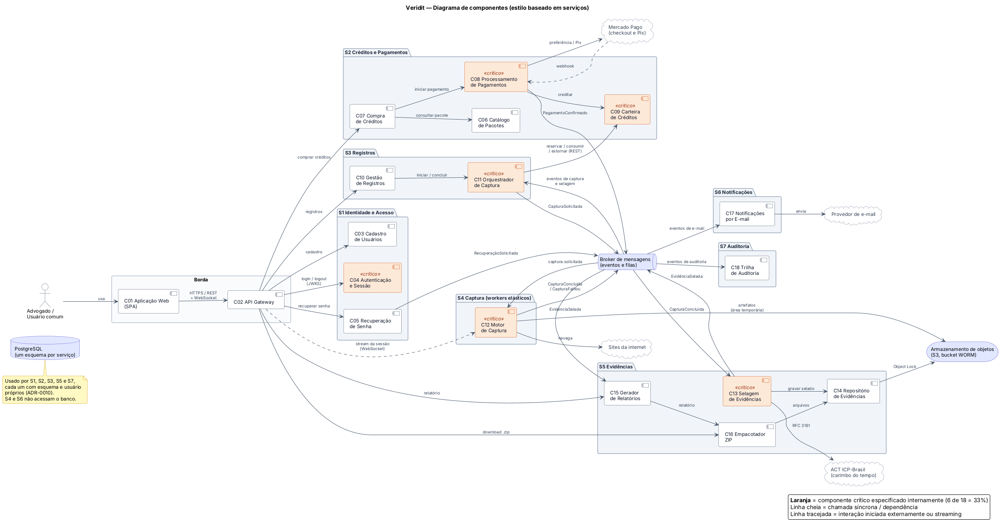

Os componentes em laranja são os críticos, especificados internamente na seção 7. As linhas
cheias indicam chamadas e dependências; as tracejadas indicam interações iniciadas por fora
(webhook) ou o streaming da sessão.

### 6.1 Fluxo principal: registro de conteúdo

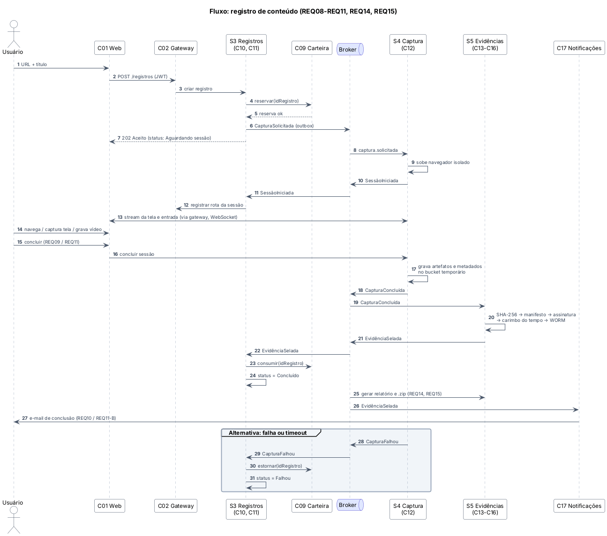

### 6.2 Fluxo principal: compra de créditos

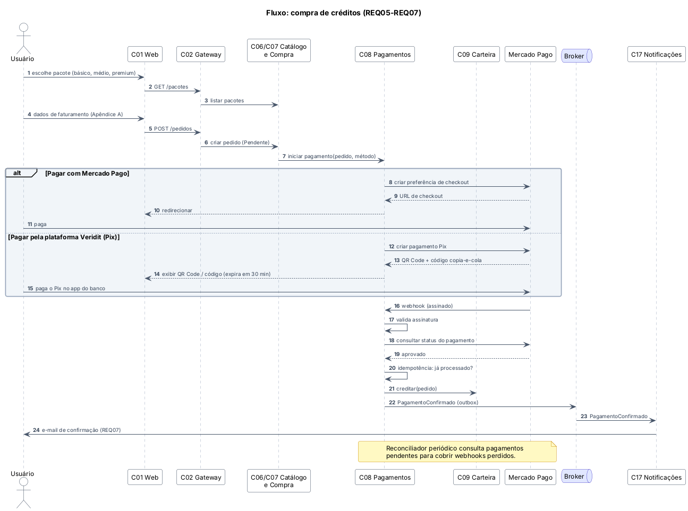

---

## 7. Especificação interna dos componentes críticos

Especificamos internamente **6 dos 18 componentes (33%)**. O critério foi: o componente é
essencial para pelo menos uma das top 4 características e sua falha compromete o produto.
Cada característica prioritária é coberta por pelo menos um componente detalhado.

| Componente | Por que é crítico | Características |
|---|---|---|
| C04 Autenticação e Sessão | Porta de entrada de todo acesso; uma falha compromete o único atributo explícito | Segurança |
| C08 Processamento de Pagamentos | Lida com dinheiro e com integração externa assíncrona (webhooks) | Segurança, Confiabilidade |
| C09 Carteira de Créditos | Guarda o saldo do usuário; corridas ou perdas geram prejuízo direto | Confiabilidade |
| C11 Orquestrador de Captura | Coordena o fluxo distribuído mais longo e mantém créditos e status coerentes | Confiabilidade, Escalabilidade |
| C12 Motor de Captura | Origem da evidência; executa conteúdo não confiável; é o mais caro e o que precisa escalar | Integridade, Segurança, Escalabilidade |
| C13 Selagem de Evidências | Transforma arquivos em evidência verificável; sem ele o produto perde o valor | Integridade |

### 7.1 C04 Autenticação e Sessão

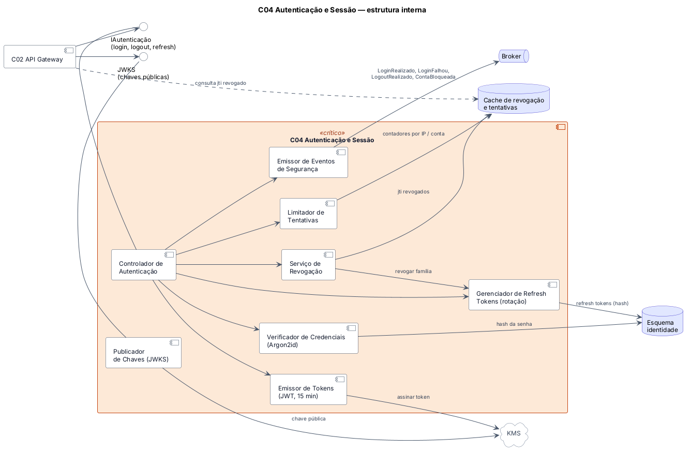

| Subcomponente | Responsabilidade |
|---|---|
| Controlador de Autenticação | Recebe login, refresh e logout; coordena os demais |
| Limitador de Tentativas | Conta falhas por IP e por conta; aplica bloqueio progressivo |
| Verificador de Credenciais | Compara a senha com o hash Argon2id |
| Emissor de Tokens | Gera o JWT de acesso (15 min), assinado via KMS |
| Gerenciador de Refresh Tokens | Emite, rotaciona e detecta reuso de refresh tokens |
| Serviço de Revogação | Revoga tokens no logout, na troca de senha e em reuso suspeito |
| Publicador de Chaves (JWKS) | Expõe as chaves públicas para o gateway validar tokens |
| Emissor de Eventos de Segurança | Publica eventos para a trilha de auditoria |

Interfaces: provê `IAutenticação` e `JWKS`; requer KMS, esquema `identidade`, cache de revogação
e broker. Decisão relacionada: ADR-0005.

### 7.2 C08 Processamento de Pagamentos

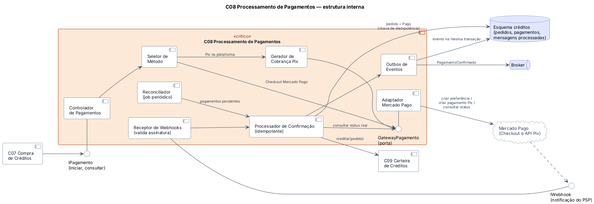

| Subcomponente | Responsabilidade |
|---|---|
| Controlador de Pagamentos | Recebe o pedido de pagamento da Compra de Créditos |
| Seletor de Método | Decide entre checkout do Mercado Pago e Pix na plataforma |
| Gerador de Cobrança Pix | Obtém QR Code e código copia-e-cola, com expiração |
| Porta `GatewayPagamento` + Adaptador Mercado Pago | Isola o modelo do provedor (camada anticorrupção); permite trocar de provedor |
| Receptor de Webhooks | Recebe notificações e valida a assinatura |
| Processador de Confirmação | Consulta o status real, aplica idempotência, marca o pedido como pago e credita a carteira |
| Reconciliador | Job periódico que confere pagamentos pendentes para cobrir webhooks perdidos |
| Outbox de Eventos | Grava `PagamentoConfirmado` na mesma transação e publica no broker |

Decisões relacionadas: ADR-0006, ADR-0007.

### 7.3 C09 Carteira de Créditos

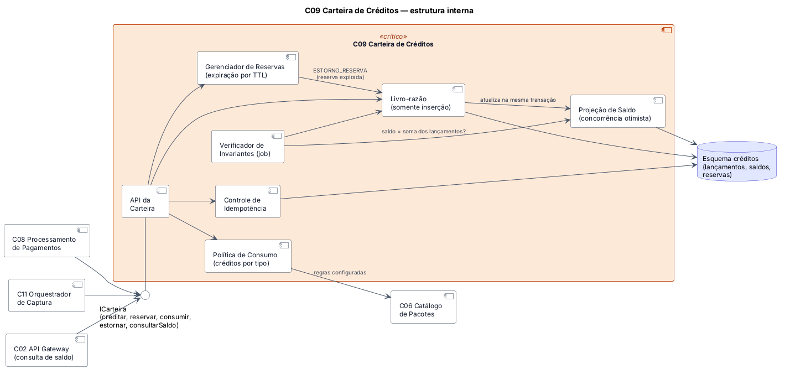

| Subcomponente | Responsabilidade |
|---|---|
| API da Carteira | Operações `creditar`, `reservar`, `consumir`, `estornar`, `consultarSaldo` |
| Controle de Idempotência | Garante que cada operação com a mesma chave tenha efeito uma vez |
| Política de Consumo | Calcula quantos créditos um registro consome, a partir do catálogo |
| Livro-razão | Lançamentos somente de inserção (compra, reserva, consumo, estorno, ajuste) |
| Projeção de Saldo | Saldo materializado com concorrência otimista, atualizado na mesma transação |
| Gerenciador de Reservas | Estorna reservas expiradas |
| Verificador de Invariantes | Job que confere se o saldo é igual à soma dos lançamentos |

Decisão relacionada: ADR-0008.

### 7.4 C11 Orquestrador de Captura

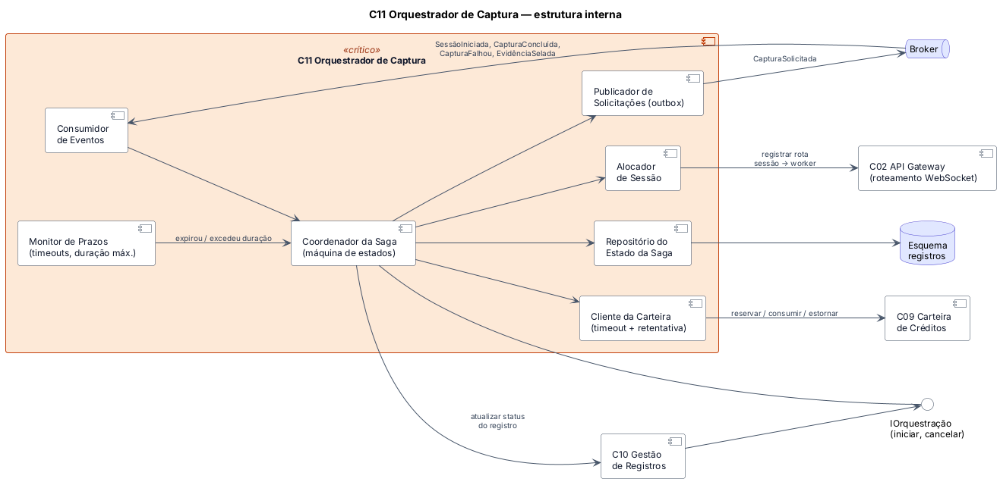

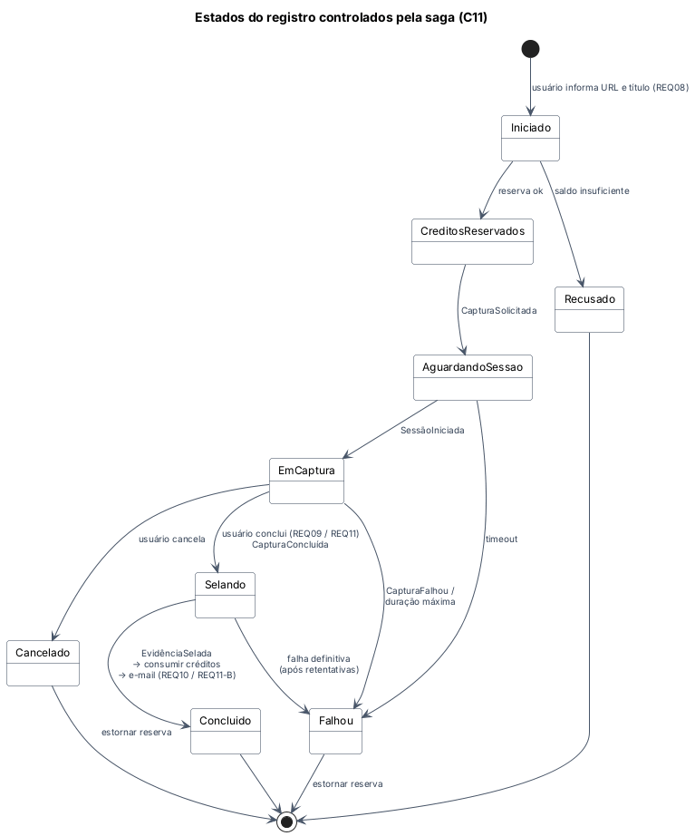

| Subcomponente | Responsabilidade |
|---|---|
| Coordenador da Saga | Máquina de estados do registro (Iniciado → … → Concluído / Falhou / Cancelado) |
| Cliente da Carteira | Chama reservar, consumir e estornar com timeout e retentativa |
| Publicador de Solicitações | Publica `CapturaSolicitada` via outbox |
| Consumidor de Eventos | Recebe `SessãoIniciada`, `CapturaConcluída`, `CapturaFalhou`, `EvidênciaSelada` |
| Alocador de Sessão | Registra no gateway a rota entre a sessão do usuário e o worker |
| Monitor de Prazos | Detecta sessões que não iniciaram, excederam a duração ou travaram |
| Repositório do Estado da Saga | Persiste o estado para retomar após falhas |

Decisões relacionadas: ADR-0007, ADR-0008, ADR-0009.

### 7.5 C12 Motor de Captura

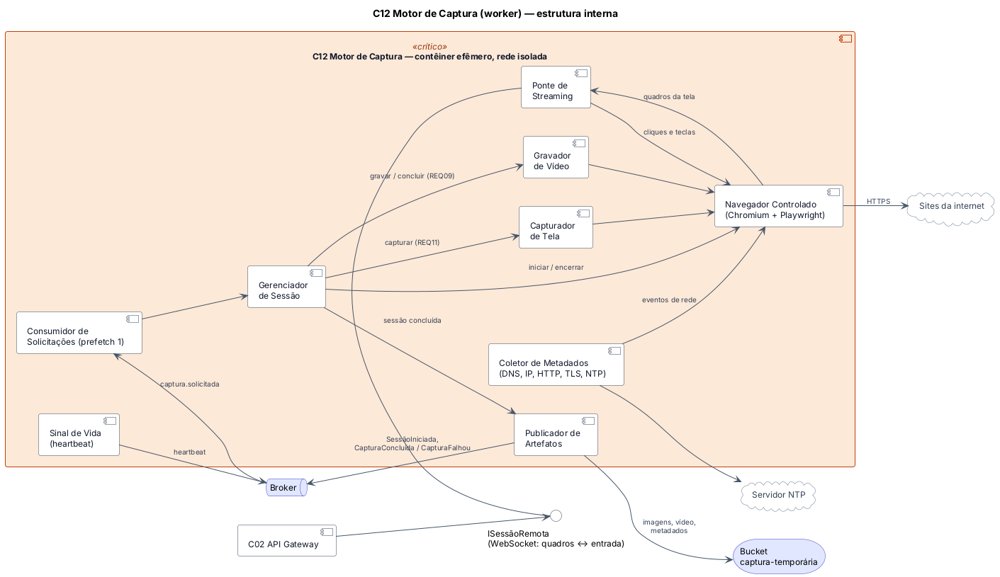

| Subcomponente | Responsabilidade |
|---|---|
| Consumidor de Solicitações | Retira uma solicitação por vez da fila (prefetch 1) |
| Gerenciador de Sessão | Ciclo de vida do navegador, limites de duração, conclusão |
| Navegador Controlado | Chromium automatizado (ex.: Playwright) em contêiner efêmero e rede isolada |
| Ponte de Streaming | Envia quadros da tela e recebe cliques e teclas via WebSocket |
| Capturador de Tela | Gera capturas de tela (REQ11) |
| Gravador de Vídeo | Grava a navegação (REQ09) |
| Coletor de Metadados | Registra URL final, IP, DNS, cabeçalhos HTTP, certificado TLS e horário NTP |
| Publicador de Artefatos | Envia arquivos ao bucket temporário e publica `CapturaConcluída` / `CapturaFalhou` |
| Sinal de Vida | Envia heartbeat para o orquestrador detectar workers travados |

Decisões relacionadas: ADR-0003, ADR-0009.

### 7.6 C13 Selagem de Evidências

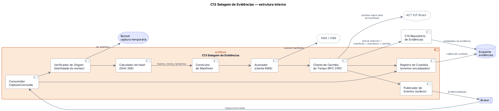

| Subcomponente | Responsabilidade |
|---|---|
| Consumidor `CapturaConcluída` | Recebe o aviso de captura concluída |
| Verificador de Origem | Confere que os artefatos vieram de um worker autenticado |
| Calculador de Hash | Calcula o SHA-256 de cada arquivo |
| Construtor de Manifesto | Monta o JSON com registro, usuário, URL, horários, metadados e hashes |
| Assinador | Assina o manifesto com a chave da plataforma no KMS |
| Cliente de Carimbo do Tempo | Obtém o carimbo RFC 3161 da ACT ICP-Brasil e grava o pacote no repositório WORM |
| Registro de Custódia | Registra cada etapa em eventos encadeados |
| Publicador de Eventos | Publica `EvidênciaSelada` via outbox |

Decisão relacionada: ADR-0004.

---

## 8. Diagrama de módulos (pacotes UML)

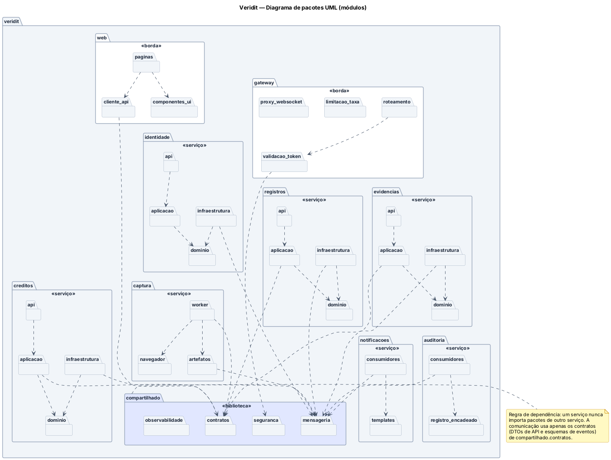

Regras de dependência:

- **Entre serviços:** nenhum serviço importa pacotes de outro. A comunicação usa apenas os
  contratos em `compartilhado.contratos` (DTOs de API e esquemas de eventos).
- **Dentro dos serviços de domínio** (`identidade`, `creditos`, `registros`, `evidencias`):
  `api` → `aplicacao` → `dominio`. A `infraestrutura` implementa as portas definidas em `dominio`
  (inversão de dependência), então o domínio não depende de banco, broker ou provedores externos.
- **Biblioteca compartilhada:** `contratos`, `mensageria` (outbox, idempotência, cliente do
  broker), `seguranca` (validação de token) e `observabilidade` (logs e correlation-id). Não pode
  conter regra de negócio.

| Pacote | Componentes |
|---|---|
| `web` | C01 |
| `gateway` | C02 |
| `identidade` | C03, C04, C05 |
| `creditos` | C06, C07, C08, C09 |
| `registros` | C10, C11 |
| `captura` | C12 |
| `evidencias` | C13, C14, C15, C16 |
| `notificacoes` | C17 |
| `auditoria` | C18 |

---

## 9. Táticas por característica

### 9.1 Segurança

| Tática | Objetivo principal | Onde |
|---|---|---|
| Autenticar atores | Garantir que só usuários cadastrados acessem o sistema | C04, C02 |
| Autorizar atores | Garantir que cada usuário acesse apenas os próprios registros e compras | C02, todos os serviços |
| Limitar acesso | Concentrar a entrada em um único ponto com TLS e limitação de taxa | C02 |
| Limitar exposição | Expor só o gateway; manter serviços e captura em redes internas isoladas | C02, C12 |
| Separar entidades | Isolar o navegador em contêiner efêmero e cada serviço em seu esquema de banco | C12, ADR-0010 |
| Criptografar dados | Proteger dados em trânsito (TLS) e em repouso (AES-256, criptografia de campo) | Todos |
| Detectar ataques de força bruta | Identificar tentativas repetidas de login e recuperação e bloquear | C04 |
| Revogar acesso | Encerrar sessões no logout, na troca de senha e em reuso de refresh token | C04 |
| Minimizar dados sensíveis | Não receber nem armazenar dados de cartão | C08 |
| Manter trilha de auditoria | Permitir investigar incidentes | C18 |

### 9.2 Integridade e autenticidade das evidências

| Tática | Objetivo principal | Onde |
|---|---|---|
| Ambiente de captura controlado | Garantir que o conteúdo veio do site, sem manipulação no dispositivo do usuário | C12 (ADR-0003) |
| Verificar integridade (hash SHA-256) | Detectar qualquer alteração em qualquer arquivo | C13 |
| Assinar o manifesto | Provar que o pacote foi emitido pela plataforma | C13 + KMS |
| Carimbo do tempo de terceiro confiável | Provar o momento da captura | C13 + ACT |
| Armazenamento imutável (WORM) | Impedir alteração ou remoção, inclusive por administradores | C14 |
| Cadeia de custódia encadeada | Documentar cada etapa entre a captura e o pacote | C13, C18 |
| Coletar metadados técnicos | Dar contexto à prova (IP, DNS, TLS, horário) | C12 |
| Verificação periódica | Detectar corrupção silenciosa | C13 (job) |

### 9.3 Confiabilidade

| Tática | Objetivo principal | Onde |
|---|---|---|
| Outbox transacional | Não perder eventos entre a gravação no banco e a publicação | C08, C11, C13 |
| Consumidores idempotentes | Obter efeito único mesmo com entrega repetida | C08, C09, C11, C17 |
| Retentativa com backoff exponencial | Superar falhas transitórias sem sobrecarregar | C11, C13, C17 |
| Fila de mensagens mortas (DLQ) | Isolar mensagens com erro sem travar a fila | Broker |
| Saga com compensação | Manter créditos coerentes quando a captura falha | C11, C09 |
| Timeout e heartbeat | Detectar sessões e workers travados | C11, C12 |
| Reconciliação | Corrigir webhooks perdidos | C08 |
| Verificação de invariantes | Detectar inconsistência no saldo | C09 |

### 9.4 Escalabilidade / elasticidade

| Tática | Objetivo principal | Onde |
|---|---|---|
| Escalonamento horizontal de workers sem estado | Aumentar a capacidade adicionando instâncias | C12 |
| Autoescalonamento pela fila | Ajustar a capacidade à demanda (elasticidade) | C12 + orquestrador |
| Fila como buffer (nivelamento de carga) | Absorver picos sem rejeitar pedidos | Broker |
| Pool aquecido | Reduzir o tempo para iniciar novas sessões | C12 |
| Limitar demanda | Controlar consumo (sessões por usuário, duração máxima) | C11, C02 |
| Validação de token sem estado | Evitar gargalo no serviço de identidade | C02, C04 |
| Cache de leituras | Reduzir carga em consultas frequentes (catálogo) | C06, C02 |

### 9.5 Disponibilidade

| Tática | Objetivo principal | Onde |
|---|---|---|
| Redundância ativa | Continuar atendendo quando uma instância falha | Todos os serviços |
| Health check e reinício automático | Detectar e substituir instâncias com falha | Orquestrador de contêineres |
| Isolamento de falhas por serviço | Impedir que falha na captura derrube login e compras | Estilo (ADR-0002) |
| Circuit breaker | Evitar falhas em cascata quando um provedor externo cai | C08, C13, C17 |
| Degradação graciosa | Manter listagem e downloads quando a captura estiver indisponível | C10, C16 |

### 9.6 Desempenho

| Tática | Objetivo principal | Onde |
|---|---|---|
| Processamento assíncrono | Não bloquear a interface com selagem, relatório e .zip | C13, C15, C16 |
| Paginação e índices | Responder rápido à listagem de registros | C10 |
| Compressão adaptativa de quadros | Manter a interação com o navegador remoto fluida | C12 |
| URLs pré-assinadas para download | Entregar arquivos sem passar pelos serviços | C14, C16 |

### 9.7 Recuperabilidade

| Tática | Objetivo principal | Onde |
|---|---|---|
| Backup com recuperação ponto a ponto | Restaurar o banco após falha ou erro humano | PostgreSQL |
| Réplica em espera (failover) | Retomar o serviço rapidamente | PostgreSQL |
| Replicação do armazenamento de objetos | Não perder evidências em falha de zona | Armazenamento de objetos |
| Teste periódico de restauração | Garantir que o backup funciona | Operação |

### 9.8 Auditabilidade

| Tática | Objetivo principal | Onde |
|---|---|---|
| Log de auditoria somente de inserção com encadeamento de hashes | Registro de eventos que não pode ser alterado sem deixar rastro | C18 |
| Correlation-id | Seguir uma operação entre serviços | `compartilhado.observabilidade` |
| Livro-razão de créditos | Histórico financeiro completo | C09 |

### 9.9 Privacidade (LGPD)

| Tática | Objetivo principal | Onde |
|---|---|---|
| Minimização de dados | Coletar só os campos do Apêndice A; nunca dados de cartão | C03, C07, C08 |
| Criptografia em nível de campo | Proteger CPF, telefone e endereço mesmo com acesso ao banco | C03, C07 |
| Mascaramento em logs | Evitar exposição acidental de dados pessoais | `compartilhado.observabilidade` |
| Política de retenção | Manter dados apenas pelo prazo necessário | C14, PostgreSQL |
| Sessão de captura descartável | Não reter cookies ou credenciais digitadas pelo usuário | C12 |

### 9.10 Extensibilidade / configurabilidade

| Tática | Objetivo principal | Onde |
|---|---|---|
| Parametrização (pacotes como dados) | Criar ou alterar pacotes sem mudar código (D2) | C06 |
| Polimorfismo para tipos de usuário | Adicionar empresas (D1) sem alterar fluxos existentes | C03 |
| Estratégia para tipos de captura | Acrescentar novos tipos de registro | C12 |
| Publicar/assinar eventos | Adicionar consumidores sem alterar produtores | Broker |
| Portas e adaptadores | Trocar provedor de pagamento ou de carimbo do tempo | C08, C13 |

### 9.11 Interoperabilidade

| Tática | Objetivo principal | Onde |
|---|---|---|
| Camada anticorrupção (adaptadores) | Isolar o modelo dos sistemas externos | C08, C13 |
| Contratos versionados (OpenAPI e esquemas de eventos) | Manter a integração estável entre serviços | `compartilhado.contratos` |
| Padrões abertos (RFC 3161, SHA-256, X.509) | Permitir verificação por terceiros | C13 |

### 9.12 Manutenibilidade e testabilidade

| Tática | Objetivo principal | Onde |
|---|---|---|
| Aumentar coesão | Concentrar cada domínio em um serviço | Estilo |
| Reduzir acoplamento | Proibir imports e joins entre serviços | Pacotes, ADR-0010 |
| Inversão de dependência | Testar o domínio sem banco ou broker | Todos os serviços |
| Funções de aptidão no CI | Verificar regras arquiteturais automaticamente | Pipeline |
| Ambiente local completo (Docker Compose) | Reproduzir o sistema inteiro para testes | Operação |

---

## 10. Decisões arquiteturais (ADRs)

As ADRs seguem o modelo padronizado em [adr/0000-modelo-adr.md](adr/0000-modelo-adr.md), com
contexto, decisão, alternativas consideradas, justificativa, consequências, conformidade e
requisitos relacionados.

| ADR | Decisão | Características |
|---|---|---|
| [0001](adr/0001-top4-caracteristicas.md) | Top 4 características | Top 4 |
| [0002](adr/0002-estilo-baseado-em-servicos.md) | Estilo baseado em serviços com mensageria assíncrona | Top 4 |
| [0003](adr/0003-captura-em-navegador-remoto-isolado.md) | Captura em navegador remoto isolado | Integridade, Segurança |
| [0004](adr/0004-selagem-das-evidencias.md) | Selagem com hash, assinatura, carimbo do tempo e WORM | Integridade |
| [0005](adr/0005-autenticacao-tokens-e-senhas.md) | JWT curto + refresh token revogável; Argon2id | Segurança |
| [0006](adr/0006-pagamentos-via-mercado-pago.md) | Pagamentos delegados ao Mercado Pago | Segurança, Confiabilidade |
| [0007](adr/0007-mensageria-outbox-e-dlq.md) | Outbox, filas duráveis, DLQ e saga | Confiabilidade |
| [0008](adr/0008-carteira-de-creditos-livro-razao.md) | Carteira como livro-razão com reserva | Confiabilidade |
| [0009](adr/0009-escalonamento-dos-workers-de-captura.md) | Workers de captura com autoescalonamento | Escalabilidade |
| [0010](adr/0010-persistencia-esquemas-e-objetos.md) | PostgreSQL com esquema por serviço + objetos | Segurança, Manutenibilidade |

---

## 11. Rastreabilidade: requisitos → componentes

| Requisito | Componentes |
|---|---|
| REQ01 Cadastrar usuário | C01, C02, C03, C17 |
| REQ02 Recuperar senha | C05, C04, C17 |
| REQ03 Logar | C04, C02 |
| REQ04 Sair | C04, C02 |
| REQ05 Comprar créditos | C06, C07, C08, C09 |
| REQ06 Efetuar pagamento | C08 |
| REQ07 Confirmar pagamento por e-mail | C08, C17 |
| REQ08 Iniciar registro | C10, C11, C09, C12 |
| REQ09 Concluir gravação | C12, C11, C13 |
| REQ10 Confirmar gravação por e-mail | C11, C17 |
| REQ11 Concluir captura de tela | C12, C11, C13 |
| REQ11-B Confirmar captura de tela por e-mail | C11, C17 |
| REQ12 Listar registros | C10 |
| REQ13 Detalhes do registro | C10, C14 |
| REQ14 Relatório | C15, C13 |
| REQ15 Arquivo .zip | C16, C14 |
| QA Segurança | C02, C04, C18 |

---

## 12. Riscos e pontos em aberto

| Risco / pendência | Impacto | Encaminhamento |
|---|---|---|
| Consumo de créditos por tipo de registro não definido (P3) | Preço e modelo da carteira | Validar com o cliente; manter configurável |
| Interpretação de "pagamento pela plataforma" (P2) | Integração de pagamento | Validar com o cliente |
| Custo de infraestrutura da captura remota | Viabilidade financeira | Limites por usuário, teto de workers, monitorar custo por registro |
| Sites que bloqueiam IPs de datacenter | Capturas incompletas | Pool de saída de rede; registrar no relatório |
| Retenção WORM x pedidos de exclusão (LGPD) | Conformidade legal | Validar base legal com assessoria jurídica |
| Complexidade operacional (broker, orquestrador) para a equipe | Prazo de implementação | Docker Compose no desenvolvimento; autoescalonamento só em produção |

---

## 13. Telas da aplicação

O protótipo das 14 telas está em [`entregas/veridit-telas.pdf`](../../entregas/veridit-telas.pdf): entrar, criar conta, recuperar senha, criar nova senha, meus registros, comprar créditos, dados de faturamento, pagamento, pagamento confirmado, novo registro, sessão de captura, selagem da evidência, detalhes do registro e relatório.

---

## Referências

- RICHARDS, Mark; FORD, Neal. *Fundamentals of Software Architecture: An Engineering Approach*. O'Reilly.
- BASS, Len; CLEMENTS, Paul; KAZMAN, Rick. *Software Architecture in Practice*. Addison-Wesley.
- ALMEIDA, Eduardo. *Documento de Requisitos — Veridit*, versão 01.00, 2026.
- IETF. RFC 3161 — Time-Stamp Protocol (TSP).
- BRASIL. Lei nº 13.709/2018 — Lei Geral de Proteção de Dados Pessoais.
