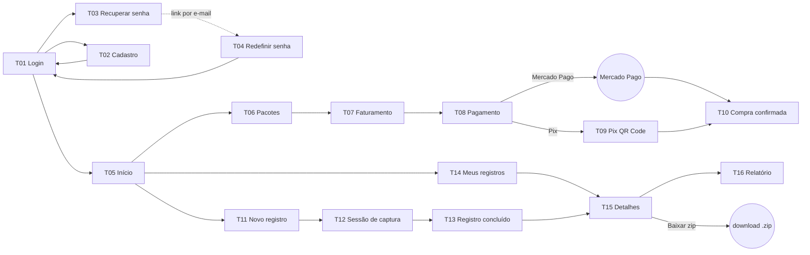

# Telas da Aplicação — Veridit (v1)

> Etapa 10 da documentação arquitetural. Lista das telas da primeira versão, com objetivo, requisitos atendidos, campos (exatamente os do Apêndice A quando o documento os define), ações e navegação. Respeita D1 (somente advogados e usuários comuns) e D2 (pacotes básico, médio e premium). Elementos que não estão no documento estão marcados como **[inferência]**. Base para os protótipos no Figma.

## Mapa de navegação

O menu superior (todas as telas após o login) tem: Início, Novo registro, Meus registros, Comprar créditos e **Sair** (REQ 04).

## Lista de telas

### Acesso

| Id | Tela | Requisitos | Campos | Ações e navegação |
|---|---|---|---|---|
| T01 | Login | REQ 03, Segurança | email, senha | Entrar → T05; "Criar conta" → T02; "Esqueci a senha" → T03 |
| T02 | Cadastro | REQ 01, D1 | Seleção do perfil: **Advogado** ou **Usuário comum**. Comuns aos dois: nome completo, email, senha, CPF. Só para Advogado: número da OAB | Cadastrar → T01. A opção "Empresa" não aparece na v1 (D1) |
| T03 | Recuperar senha | REQ 02 | email **[inferência: mecanismo por e-mail]** | Enviar → mensagem "se o e-mail estiver cadastrado, você receberá um link" |
| T04 | Redefinir senha | REQ 02 | nova senha, confirmação **[inferência]** | Salvar → T01 |

### Créditos

| Id | Tela | Requisitos | Campos | Ações e navegação |
|---|---|---|---|---|
| T05 | Início | REQ 03, 04 | Saldo de créditos **[inferência: o documento não pede consulta de saldo, mas o usuário precisa saber se pode iniciar um registro]**; últimos registros | Atalhos para T06, T11 e T14; Sair (REQ 04) |
| T06 | Pacotes de créditos | REQ 05, D2 | Para cada pacote (básico, médio, premium): nome, quantidade de créditos, valor por crédito, descrição dos benefícios | Selecionar pacote → T07 |
| T07 | Dados de faturamento | REQ 05 | nome completo, email, telefone, cpf, cep, endereço, número, complemento, bairro, cidade, estado | Continuar → T08; Voltar → T06 |
| T08 | Pagamento | REQ 06 | Resumo do pacote escolhido; meio de pagamento: **Mercado Pago** ou **Pix** | Mercado Pago → ambiente do Mercado Pago → T10; Pix → T09 |
| T09 | Pagamento por Pix | REQ 06 | QR Code; número Pix (copia e cola); situação "aguardando pagamento" | Atualiza sozinha quando o pagamento é confirmado (ADR-007) → T10 |
| T10 | Compra confirmada | REQ 05, 06, 07 | Pacote, créditos adicionados; aviso de que a confirmação foi enviada por e-mail (REQ 07) | Ir para Novo registro (T11) ou Início (T05) |

### Registro de conteúdo

| Id | Tela | Requisitos | Campos | Ações e navegação |
|---|---|---|---|---|
| T11 | Novo registro | REQ 08 | Endereço do site, título do registro do conteúdo (Apêndice A); tipo: **captura de tela** ou **vídeo de navegação** **[inferência: ver `componentes.md`, seção 2]** | Iniciar → T12 (reserva o crédito, ADR-009). Sem saldo: aviso e link para T06 |
| T12 | Sessão de captura | REQ 08, 09, 11 | Navegador remoto (ADR-002) ocupando a tela; barra com url atual, tempo decorrido, indicador "gravando" (modo vídeo) e número de imagens (modo tela) | Modo tela: "Capturar tela" (várias vezes) e "Concluir captura" (REQ 11). Modo vídeo: "Concluir gravação" (REQ 09). Ambos → T13 |
| T13 | Registro concluído | REQ 09, 10, 11, 11 dup. | Título, data/hora início e fim, número de imagens e vídeos; aviso de que a confirmação foi enviada por e-mail | Ver detalhes → T15 |

### Consulta e exportação

| Id | Tela | Requisitos | Campos | Ações e navegação |
|---|---|---|---|---|
| T14 | Meus registros | REQ 12 | Tabela com: Título, Data/hora início, Data/hora fim, Detalhes, status (Apêndice A, "Registros realizados"). Status conforme ADR-009 | Detalhes → T15 |
| T15 | Detalhes do registro | REQ 13, 14, 15 | id gerado pelo sistema, Título, Data/hora início, Data/hora fim, tipos de dados registrados, informações dos dados (número de imagens e vídeos), usuário responsável pelo registro (Apêndice A, "Detalhes dos registros") | "Gerar relatório" → T16 (REQ 14); "Baixar arquivo zip" → download (REQ 15) |
| T16 | Relatório do registro | REQ 14 | Título, id gerado pelo sistema, Usuário, CPF, id do registro gerado pelo sistema, Data/hora início, Data/hora fim, duração, imagens capturadas, site da imagem, url do site navegado, nome do arquivo gerado pelo sistema, tamanho do arquivo (Apêndice A). Hashes e manifesto conforme ADR-005 **[inferência]** | Baixar relatório (formato PDF **[inferência]**); Voltar → T15 |

## Observações

- **16 telas** cobrem os REQ 01 a 15, a Segurança (todas as telas após T01 exigem login) e as decisões D1 e D2.
- A **T12** é a tela que mais depende da arquitetura: o usuário vê e controla um navegador que roda no servidor (ADR-002), por isso precisa mostrar com clareza o que está sendo gravado e quanto tempo falta para o tempo limite (ADR-009).
- Registros com status `INTERROMPIDO` aparecem na T14 com destaque e explicação (ADR-009).
